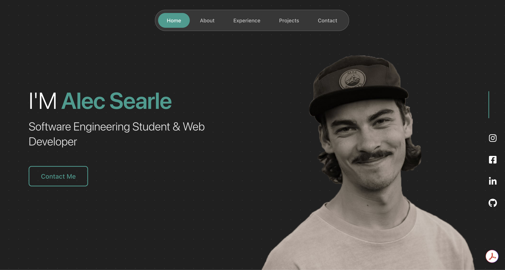

# portfolio.alecsearle.com

Personal portfolio for Alec Searle: software engineer at Zonos and freelance web developer based in St. George, Utah.



## About the site

A single-page portfolio with About, Experience, Projects, and Contact sections. The hero has an interactive dot grid (GSAP) that reacts to the cursor, the Experience timeline fills in as you scroll, and project cards get a cursor-following border glow on desktop. Touch devices and `prefers-reduced-motion` get a calmer, static version.

## Editing content

All copy (experience, projects, links, quick facts) lives in [`src/data.js`](src/data.js). Project screenshots go in `public/projects/` (JPGs around 1200px wide keep the page light).

## Development

```bash
npm install
npm run dev     # local dev server
npm run build   # production build to dist/
npm run lint
```

## Tech stack

- React 19 + Vite
- Plain CSS with shared design tokens in `src/index.css`
- GSAP (dot grid physics, scroll animations)
- React Icons
